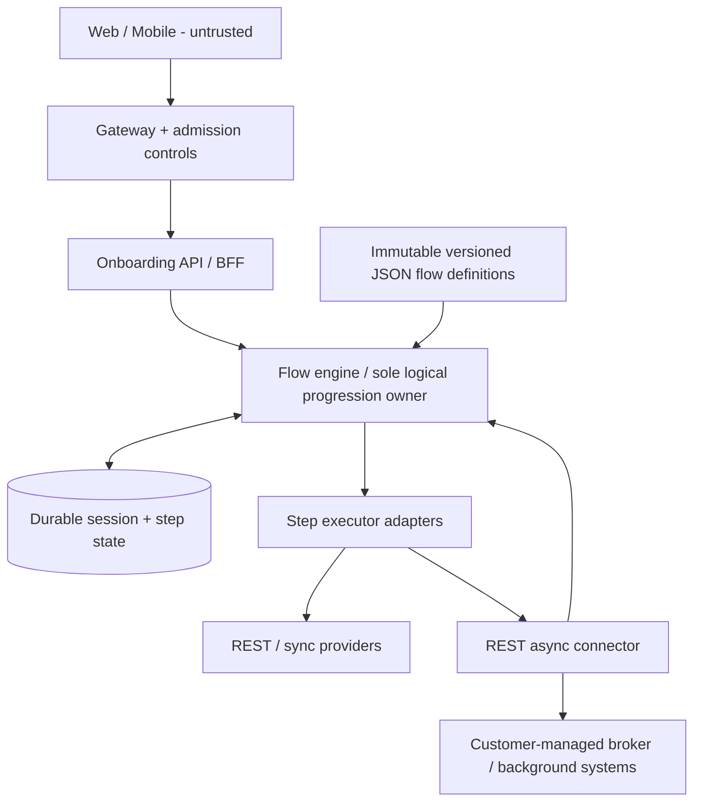

# Conceptual Architecture

**Status:** Current direction; NOT a final deployment diagram.

**What is important:** The API, flow controller and step executors can live in **one deployable application**. Separate logical responsibilities are not automatically microservice boundaries. Frontend polling does not perform backend retries.

## Four activity categories (may be freely interleaved)

1. Identity verification: phone/email OTP, KYC provider, selfie/document verification.
2. Customer data: identity attributes, residency, purpose/use-of-service questions.
3. Internal/external checks: fraud, risk, national registries and bank internal verification.
4. Approval, customer selection and provisioning: eligibility, account/subscription selection, CRM/core banking/account/card/settings.

The **business designer determines step boundaries** (one screen with one or many fields, or a backend activity). V1 flow definitions form a forward-only directed graph with conditional branches; WAITING is a runtime state. The engine orchestrates the full journey through provisioning and completion.

## Asynchronous step example

1. On reaching `assess-risk`, the engine makes a configured REST request to a customer-owned async connector.
2. The connector starts background work (Kafka, RabbitMQ, etc. are **outside** the engine) and returns a polling ID.
3. The engine stores the polling ID, marks the step waiting, and polls the connector independently of mobile polling. The mobile receives `nextStep: WAIT` while pending.
4. When the connector reports HTTP `200`, the engine stores mapped results and resolves the forward transition. Connector errors follow explicit business/technical failure policies.
5. Timeout or expiry must not revive an expired onboarding. **Open:** the exact HTTP status/payload indicating still-processing; `202 Accepted` is only a candidate.

## Security boundaries

Internet traffic -> gateway/admission -> authorized onboarding API -> flow engine -> allowlisted integrations. No client-selected arbitrary URL/activity; all transitions validated against the pinned flow version. OTP-based identity/access proof and CAPTCHA/bot resistance are different controls.

## Phone collection + verification example (current agreed direction)

1. `collect-phone`: API returns phone input schema; mobile submits phone; engine stores it.
2. `captcha-before-sms`: explicit CAPTCHA business-flow step; client completes the configured challenge, engine validates the token server-side and records completion.
3. `send-sms`: configured OTP-send REST action, reached only after the CAPTCHA step is completed; independent rate limits and quotas still apply.
4. `verify-phone`: API returns code-entry input schema; mobile displays code entry, submits code **only to onboarding API**.
5. The engine maps the code + stored phone + authorized context to the configured REST validation service. It does not forward arbitrary incoming headers.
6. Success completes verification and advances. Mapped `INVALID_CODE` returns the same step with an error and attempt budget; exhausted attempts may end/lock the onboarding subject to policy. Transient technical failures use bounded retries and separate failure handling.
7. Only selected output attributes are retained/exposed. The mobile does not integrate directly with the OTP service or supply a verification JWT in this model.

## Step execution model

- **Storage-only:** persist the schema-validated input and advance.
- **REST:** call allowlisted configured endpoint with explicit input/header mapping and retry/business response policy.
- **Async:** call a customer-owned REST connector to start background work, store the returned polling ID, and poll the connector while `WAITING`. No native broker client is required.
- **Terminal:** allow successful completion and unsuccessful termination. **Open:** special terminal step versus terminal transition.

A customer-input step may invoke an action before advancing. CAPTCHA is an explicitly configured step in the flow, not a separately injected `nextStep`; its successful verification is recorded in persisted step history. Independent spending, rate, and abuse limits still protect chargeable actions. A business step can contain one or many fields.

### Agreed forward branching expression (2026-11-15)

- A step's `next` may be a plain target step ID for unconditional progression, or an `if` / `then` / `else` object for conditional forward progression.
- Conditions use **CEL (Common Expression Language)**, evaluated against server-controlled step results, not arbitrary executable code.
- Example: `{"next":{"if":"result.score >= 70","then":"premium-account","else":"standard-account"}}`.
- Validate and compile CEL conditions when loading a versioned flow definition, instead of reparsing them on each request.
- All referenced target steps must exist and move forward; loops/backward transitions remain out of scope for v1.
- Invalid OTP attempts, integration retries, and async timeouts are execution/error policies, not necessarily branching transitions.
- The exact CEL library is **not yet selected**.

## Agreed integration correlation (2026-11-15)

- `onboardingId` is the common correlation identifier for a journey. The engine **extracts it from the verified session JWT**, rather than trusting an independently supplied client value.
- Persist `onboardingId` as a lookup key in the onboarding database and associate all step state/pending actions with it.
- Add `X-Onboarding-ID: <onboardingId>` to **both sync and async connector REST calls**. The trusted JWT is the source of the identifier.
- The engine associates each connector polling ID with its onboarding session and waiting step. Connector authentication, poll intervals, expiration and retries require detailed design.
- Transactional outbox is a possible implementation pattern, **not selected**; broker publication and correlation belong to the customer connector, not the core engine.

## Session expiration and resume (agreed)

- Persistent onboarding sessions expire; configurable lifetime with **1 hour** as proposed default. Completing each business step moves the expiry forward by a configurable amount.
- The signed JWT carries the trusted `onboardingId`. Resume validates it and looks up that ID in the database; only an existing, unexpired session can resume and resolve its next step.
- On expiry delete the session and its session-scoped step/user data. Cleanup implementation and separation from legally required audit records are detailed-design questions.
- The JWT `exp` and database TTL are separate validity checks; refreshing a JWT cannot revive deleted session data.

## Editing earlier data versus forward-only execution

A client Back action may reopen an earlier completed business step, without introducing backward edges into the configured flow graph. When the user resubmits that step, preserve its prior attempts and invalidate all subsequent step results; re-resolve the forward journey. A future **point-of-no-return** boundary must prevent edits that would re-trigger irreversible operations (e.g., already provisioned accounts). Boundary configuration and enforcement remain open design work.

## Industry-agnostic flow selection (agreed)
The engine is for any adopting organization, not banks only. Client applications specify the desired flow `type` at onboarding start. The engine uses that type to resolve a server-configured flow; it must not accept an arbitrary client-supplied flow definition. Authorization/validation policy remains to be specified.

## Entry step and version nomenclature (2026-11-16)

The flow config declares `startStep` explicitly, independent of step array order. Step submission attempts use an incrementing integer `submission_version`, separate from flow definition versions and database migrations. CAPTCHA gates precede SMS and email OTP sends.

## Decision — Single flow controller and explicit CAPTCHA steps (2026-11-16)

- The **sole flow resolver** reads the configured JSON graph (`startStep`, steps, transitions) and persisted completed-step history to determine the current/next executable step. It validates the permitted sequential path and evaluates forward conditional transitions as necessary.
- Incomplete async execution yields `WAIT`; only a successfully completed step permits forward advancement. Back-navigation/resubmission invalidates subsequent completions under the agreed rules.
- **CAPTCHA is a normal, explicit flow step** with server-side verification. The client sees it through the standard `nextStep` contract. A successful provider validation is persisted as a completed step; later provider-token expiry does **not** undo that completion.
- If the designer wants CAPTCHA twice, it must appear **twice as two distinct step IDs** in the configured path. The flow controller does not secretly insert CAPTCHA or independently override `nextStep`.
- Destination/global rate limits, budget circuit breakers, and other abuse controls remain independent safeguards, **not an alternative controller for the journey**.
- **Decided:** `transitions` live at flow level, separate from step definitions, and are interpreted by the single resolver.

### Step integration boundary (agreed 2026-11-16)
`integration` is optional on every configured step. A step can operate solely on user input; when present, an integration declares `type`, `mapping`, and `connectivity` for an external REST or async-REST connector. The engine must not require a connector for step types that need none.

## Latest OTP step classification (2026-11-16)

Mobile-visible business steps: `phone` (`USER_INPUT`) → `captcha` (`CHALLENGE`) → `initiate-otp` (`CHALLENGE`) → `confirm-otp` (`USER_INPUT`) → `address` (`USER_INPUT`) → `risk` (`async-rest`); later steps follow separately configured transitions. `initiate-otp` executes its configured delivery REST integration, whereas `confirm-otp` receives an input matching its JSON Schema and executes its verification REST integration. The mobile does not receive an `INTERNAL` step or integration details. The `integration` object is optional. This supersedes earlier examples exposing `send-sms` as a separate `INTERNAL` step or classifying OTP confirmation as `CHALLENGE`.

### Example order — phone verified before address (2026-11-16)

`phone → captcha → initiate-otp → confirm-otp → address → risk` (then configured completion path). The flow-level transition from `confirm-otp` points to `address` on successful verification; `address` points to `risk`.

## Canonical flow baseline — 2026-11-16

See `../specs/002-flow-engine-mvp/examples/flow.json` and its README. Step execution invokes its configured integration; transition routing is external to steps. The engine automatically executes internal work, returns only user-facing steps, and uses WAIT for async work. Conceptual architecture is complete; detailed connector mappings/wire formats are deferred.
